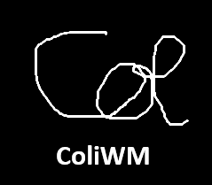

  

  # ColiWM
tilling window manager written in Python.

Keybindings:

Alt + Return: Xterm

Alt + D: dmenu

ALT + J or ALT + K: Cycle focus through managed windows

ALT + H or ALT + L: Shrink / grow master area width

ALT + A: Moves window on other sides

ALT + C: Closes window

ALT + M: toggle moncle layout

ALT + SHIFT + Q: logouts wm

Pre-installed apps on NixOS:

Dolphin

XTerm

Python

Gedit

Dmenu

alacritty

Firefox

The config file was stored inside ~/.config/coliwm/coliconfig.py.
